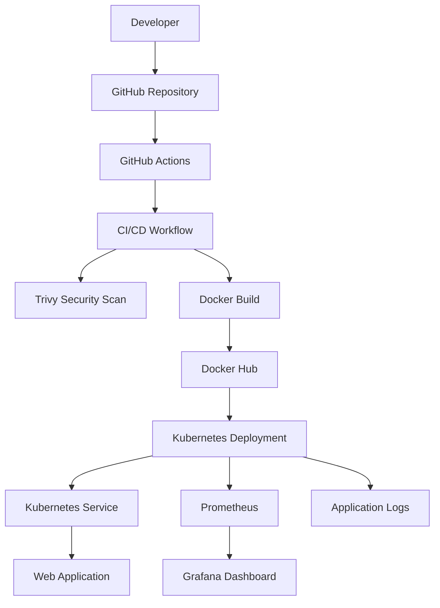

# DevOps Capstone - System Architecture

## 1. Architecture Diagram

## 2. Workflow Explanation

1. Developer pushes source code to GitHub.
2. GitHub Actions runs the configured CI/CD workflows.
3. Trivy performs security scanning in the CI/CD workflow.
4. Docker image is built and published to Docker Hub.
5. Kubernetes Deployment runs the application container.
6. Kubernetes Service exposes the application.
7. Prometheus collects cluster metrics.
8. Grafana displays monitoring dashboards.
9. Application logs can be inspected using kubectl.

## 3. Recovery and Deployment Strategies

- Self-healing: Kubernetes replaces deleted application pods.
- Backup: Kubernetes Deployment and Service configurations are saved as YAML files.
- Restore: Saved YAML files are applied to recreate resources.
- Rolling Update: Kubernetes gradually updates application replicas.

## 4. Current Implementation Scope

Implemented and demonstrated:
- GitHub Actions workflows
- Docker image build and publishing
- Kubernetes Deployment and Service
- Prometheus and Grafana monitoring
- Application log inspection
- Pod self-healing
- Configuration backup and restore
- Rolling update

Not yet implemented:
- Terraform or Ansible infrastructure provisioning
- Centralized log aggregation
- Automated Kubernetes deployment triggered directly by GitHub Actions
